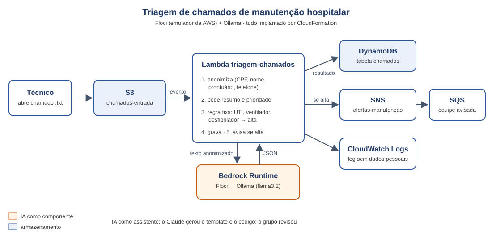

# Arquitetura

## Passo a passo de um chamado

1. **Entrada (S3).** O chamado chega como arquivo `.txt` no bucket `chamados-entrada-<conta>`. O evento `s3:ObjectCreated` aciona a Lambda.
2. **Anonimização (Lambda).** Antes de qualquer chamada ao modelo, a função troca CPF, nomes, prontuário, telefone e e-mail por marcadores. O texto original não sai do bucket de entrada.
3. **Classificação (Bedrock).** O texto anonimizado vai entre `<chamado>` para a Converse API, com prompt de sistema curto, `temperature` 0 e `maxTokens` 200. O modelo devolve JSON com equipamento, resumo e prioridade. No Floci, quem responde é o llama3.2 no Ollama.
4. **Regra fixa (Lambda).** Se o texto tem termos críticos (UTI, ventilador, desfibrilador, suporte à vida, centro cirúrgico, "parou", "não liga"), a prioridade final é alta, não importa o que o modelo disse. Se o modelo discordou, o chamado vai para revisão humana. Se o modelo falhar, também vira alta.
5. **Gravação (DynamoDB).** A tabela `chamados` guarda prioridade final, prioridade do modelo, motivo da decisão, texto anonimizado, tokens e latência.
6. **Alerta (SNS → SQS).** Chamados de prioridade alta são publicados no tópico `alertas-manutencao`, que entrega na fila `fila-manutencao` (na AWS real, também em e-mail ou SMS da equipe).
7. **Logs (CloudWatch).** Cada triagem gera uma linha de log em JSON, sem o texto do chamado.

## Por que cada peça

| Peça | Motivo |
|---|---|
| S3 + evento | Entrada simples e desacoplada: quem abre o chamado não precisa saber nada da IA. |
| Lambda | Só roda quando chega um chamado; sem servidor ligado à toa (custo e TI Verde). |
| Bedrock | Modelo gerenciado, cobrado por token; nesse volume custa poucos dólares por mês. |
| Regra fixa no código | A IA pode errar ou ser manipulada; a regra garante que emergência nunca fica com prioridade baixa. |
| DynamoDB sob demanda | Paga por gravação, sem capacidade parada. |
| SNS + SQS | O aviso chega na hora para a equipe e fica guardado na fila se ninguém estiver olhando. |

## Assistente de IA no desenvolvimento

O Claude gerou o template e o código, e o grupo revisou cada parte (ver o diário de prompts). No VS Code, o Claude Code com os servidores MCP `aws-docs` e `aws-knowledge` é usado para operar o projeto no Floci. O perfil e o endpoint do Floci ficam fixos no projeto para o assistente nunca operar uma conta real.
